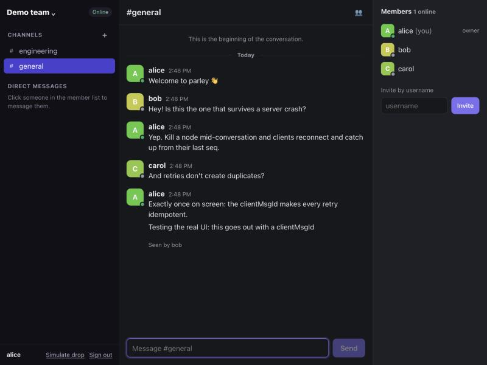
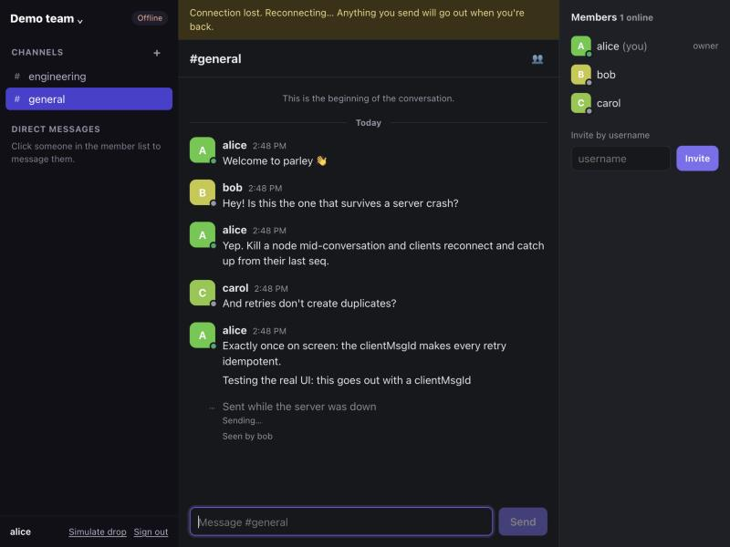
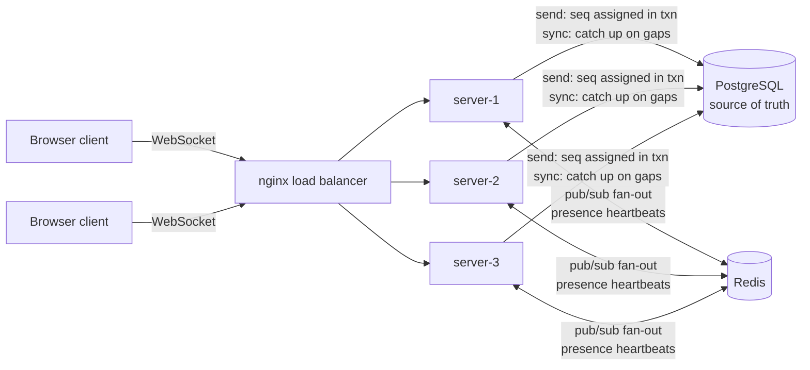

# parley

[](https://github.com/b-amit11/parley/actions/workflows/ci.yml)

A real-time chat platform (workspaces, channels, DMs) designed to run as several identical servers
behind a load balancer, without losing, duplicating or reordering messages.

**Stack:** TypeScript · Node 24 · Fastify · WebSockets · PostgreSQL 17 · Redis 7 · React 19 · Docker · nginx · Prometheus · Vitest

**[Design doc →](DESIGN.md)** covers requirements, architecture, trade-offs and failure modes.

## Results

Three servers behind nginx, on one laptop ([method and raw data](docs/loadtest.md)):

| | Connections | Sends/s | Deliveries/s | Delivery p50 / p99 | Every message exactly once, in order |
|---|---:|---:|---:|---|:-:|
| Steady load | 2,000 | 1,017 | 19,328 | 1 ms / 5 ms | ✅ |
| One server SIGKILLed mid-run | 1,000 | 506 | 9,607 | 2 ms / 135 ms | ✅ |

The load test runs the real client engine, then checks every client's timeline against Postgres.
It also caught a failover problem: nginx defaults made reconnects take **11 s** after a crash. The
[write-up](docs/loadtest.md#1-failover-took-11-seconds-instead-of-1) explains it, and fixing it brought p99 down to 135 ms.

| Live chat with read receipts | Server killed mid-conversation |
|---|---|
|  |  |

On the right, the server has been killed. The message stays "Sending…", the client reconnects with
backoff once the server is back, and the message is stored **exactly once** (seq 7, no gap).

## What makes it interesting

- **One order per channel, everywhere.** Postgres hands out a sequence number per channel inside the
  send transaction (the row lock serializes writes to that channel). Every client on every server
  sees the same order, with no gaps.
- **Retries are harmless.** Clients send a `clientMsgId`; a unique key turns any retry, even racing
  on two servers at once, into the original message. A race that loses rolls back, so its sequence
  increment is undone too and seq values stay contiguous.
- **No message is lost, even though Redis pub/sub can drop some.** Pub/sub is just the fast path
  between servers. Clients track the last `seq` they've seen, notice gaps, and `sync` from
  Postgres, the source of truth.
- **Servers keep no session state.** Any client can connect to any server. Each server
  subscribes to a Redis channel only while one of its own sockets needs it.
- **Online status survives crashes.** Each server refreshes its own connections in Redis; when a
  server dies they expire, and an atomic sweep run by every server announces each user offline
  exactly once, with no leader election.
- **Protected against overload.** Frames from one socket are processed in order with a limit on
  how many can wait, slow clients are disconnected before they can exhaust memory, and every
  frame is validated against shared zod schemas.



Servers are stateless Node processes; any client can connect to any server.

## Tested across servers, against real infrastructure

The integration tests start **two server instances** against real Postgres and Redis and check:
- delivery to a client connected to the other server;
- one identical, gapless order with three concurrent senders split across both servers, and each
  sender's messages kept in the order they sent them;
- retries racing on two servers producing exactly one message, with no gap in seq;
- catching up after reconnecting to a *different* server;
- non-members can't subscribe, send, sync or read history;
- malformed frames get an error without closing the socket; unauthenticated sockets get a 401;
- servers unsubscribe from Redis when their last local listener leaves;
- online status works across servers, several tabs count as one user, and users go offline when
  their server "crashes";
- typing indicators are throttled and not echoed back; read receipts only move forward and drive
  unread counts;
- send limits hold across all of a user's connections on both servers, and failed logins are
  limited.

## The web client

`apps/web` is a React app, but the delivery logic lives in a separate engine
([`ChatClient`](apps/web/src/lib/client.ts)) that the UI reads through `useSyncExternalStore`:
- a message shows as pending immediately, and is resent with the same `clientMsgId` after any
  reconnect until acked; rate-limited sends retry after `retryAfterMs`;
- messages are deduplicated and ordered by seq; a message arriving ahead of a gap waits while a
  `sync` fills the gap ([`timeline.ts`](apps/web/src/lib/timeline.ts), pure functions);
- reconnects use exponential backoff with jitter, then resubscribe, sync each open channel from its
  head, and resend everything pending;
- live unread badges, typing indicators, online dots and "Seen by".

The engine is tested **with the same code the browser runs**, against two real servers in
Node: pending → confirmed, sends while offline delivered exactly once, catch-up after a drop, and
unread, read, typing and online state.

## Run it

```bash
npm install
npm run db:up        # Postgres and Redis in Docker
npm test             # 40 tests (server + client engine)
npm run seed         # demo users alice / bob / carol, password "parley-demo"
npm run dev          # server on :3000 (runs migrations on start)
npm run dev:web      # web app on http://localhost:5173

npm run cluster:up   # 3 servers + nginx on http://localhost:8080, Prometheus on :9090
docker compose run --rm loadtest --channels 100 --members 20 --rate 0.5 --duration 60
```

Requires Node 24+ and Docker.

### Hosted demo (one container)

`deploy/single.Dockerfile` runs the server and the built web app in one process (API under
`/api`, WebSockets on `/ws`), for free-tier hosts without a load balancer. `render.yaml` is a
Render Blueprint that creates the service plus a Redis-compatible Key Value instance; Postgres
comes from any provider (for example Neon) via `DATABASE_URL`. With `SEED_DEMO=true` the demo
users `alice`, `bob` and `carol` (password `parley-demo`) are created on start. CI builds this
image and smoke-tests it on every push.

## Roadmap
1. ✅ Server core: auth, workspaces/channels/DMs, ordered and duplicate-safe sends, fan-out across servers, sync
2. ✅ Online status, typing indicators, read receipts and unread counts, rate limiting
3. ✅ React web client: pending sends, automatic reconnect plus sync, unread badges, typing, online status, "Seen by"
4. ✅ Three servers behind nginx in Docker Compose, Prometheus metrics, load and crash testing ([results](docs/loadtest.md))

## License

[MIT](LICENSE)
